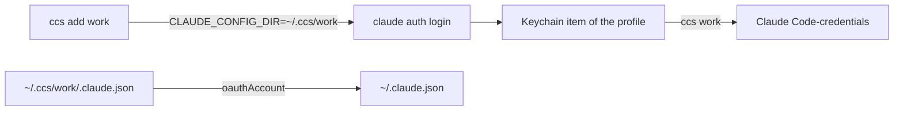

<div align="center">

<h1>ccs</h1>

<p><strong>Switch Claude Code accounts on macOS with one command.</strong></p>

[](https://github.com/zyx1121/ccs/actions)
[](https://github.com/zyx1121/ccs/releases)
[](LICENSE)

**English** | [繁體中文](README.zh-TW.md) | [简体中文](README.zh-CN.md)

</div>

```console
$ ccs
  loki  loki@winlab.tw
* mike  lms025187@winlab.tw
$ ccs loki
switched to loki (loki@winlab.tw)
restart running Claude Code sessions to use it
```

Use it when you have more than one Claude account on one Mac. You log in to each account once, then you switch in about 0.1 seconds.

## Features

- **Add an account**: `ccs add <name>` runs the official `claude auth login` and saves the result.
- **Switch the account**: `ccs <name>` changes the account that every new Claude Code session uses.
- **Keep MCP logins**: a switch replaces only the Claude token, so your MCP server logins stay.
- **Keep rotated tokens**: before a switch, ccs saves the newest token of the account you leave.

## Quick start

```sh
cargo install --git https://github.com/zyx1121/ccs
ccs add loki
```

```text
Opening browser to sign in…
Login successful.
added loki (loki@winlab.tw)
```

## Usage

| Command | Does |
|---------|------|
| `ccs` | Lists the accounts. `*` marks the active one. |
| `ccs add <name> [args]` | Logs in and saves the account as `<name>`. Extra args go to `claude auth login`, for example `--email`. |
| `ccs <name>` or `ccs switch <name>` | Makes `<name>` the active account. |
| `ccs rm <name>` | Forgets `<name>`. The account stays logged in where it is active. |

Add the account you use now before your first switch. Otherwise ccs refuses, because a switch would log that account out.

## Configuration

| Key | Sets | Default |
|-----|------|---------|
| `CCS_HOME` | Directory that holds one profile per account | `~/.ccs` |

## How it works



Each account is a Claude Code profile in `~/.ccs/<name>`. Claude Code keeps its token in the macOS Keychain, in an item named after the profile path. A switch copies the token into the default item and the identity into `~/.claude.json`, under the same locks Claude Code uses for a token refresh.

## For AI agents

Facts for coding agents and LLM tools. The rules for changing the code are in [AGENTS.md](AGENTS.md).

- **Summary**: CLI that stores several Claude Code logins and switches the active one on macOS.
- **Type**: cli
- **Interfaces**: CLI `ccs`
- **Install**: `cargo install --git https://github.com/zyx1121/ccs`
- **Run**: `ccs <name>`
- **Verify**: `ccs && claude auth status --json`
- **Config**: `CCS_HOME`
- **Secrets**: OAuth tokens stay in the macOS login Keychain, never in files. A repaired switch keeps a token of unknown owner in the `ccs-recovery` item.
- **Limits**: macOS only. Running sessions keep the old account until they restart. ccs switches only the default profile, not a `CLAUDE_CONFIG_DIR` profile.

## Development

```sh
git clone https://github.com/zyx1121/ccs && cd ccs
cargo test
```

CI runs `cargo fmt`, `clippy`, the tests and a release build on macOS.

## License

[MIT](LICENSE)
