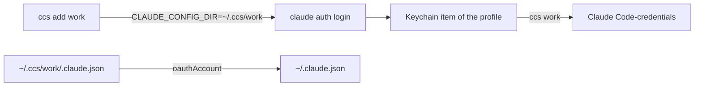

<!-- 翻译自 README.md 初版。只翻 "For AI agents" 以上的章节，英文版更新时一起改。 -->

<div align="center">

<h1>ccs</h1>

<p><strong>在 macOS 上用一个命令切换 Claude Code 账号。</strong></p>

[](https://github.com/zyx1121/ccs/actions)
[](https://github.com/zyx1121/ccs/releases)
[](LICENSE)

[English](README.md) | [繁體中文](README.zh-TW.md) | **简体中文**

</div>

```console
$ ccs
  loki  loki@winlab.tw
* mike  lms025187@winlab.tw
$ ccs loki
switched to loki (loki@winlab.tw)
restart running Claude Code sessions to use it
```

一台 Mac 上有多个 Claude 账号时用它。每个账号登录一次，之后切换约 0.1 秒。

## 功能

- **添加账号**：`ccs add <name>` 运行官方的 `claude auth login`，并保存结果。
- **切换账号**：`ccs <name>` 改变之后每个新 Claude Code session 使用的账号。
- **保留 MCP 登录**：切换只换 Claude 的 token，MCP 服务器的登录不受影响。
- **保留轮换后的 token**：切换前，ccs 先保存要离开的账号最新的 token。

## 快速开始

```sh
cargo install --git https://github.com/zyx1121/ccs
ccs add loki
```

```text
Opening browser to sign in…
Login successful.
added loki (loki@winlab.tw)
```

## 用法

| 命令 | 作用 |
|------|------|
| `ccs` | 列出账号，`*` 标出当前账号。 |
| `ccs add <name> [args]` | 登录并保存为 `<name>`。多余的参数交给 `claude auth login`，例如 `--email`。 |
| `ccs <name>` 或 `ccs switch <name>` | 把 `<name>` 设为当前账号。 |
| `ccs rm <name>` | 删除 `<name>`。正在用的账号仍保持登录。 |

第一次切换前，先把当前账号加进来。否则 ccs 会拒绝，因为切换会让那个账号登出。

## 配置

| 变量 | 设置 | 默认 |
|------|------|------|
| `CCS_HOME` | 存放每个账号 profile 的目录 | `~/.ccs` |

## 工作原理



每个账号是 `~/.ccs/<name>` 里的一个 Claude Code profile。Claude Code 把 token 存在 macOS 钥匙串，条目名称由 profile 路径算出。切换时，ccs 把 token 复制到默认条目、把身份写进 `~/.claude.json`，过程中持有 Claude Code 刷新 token 时用的同一组锁。
