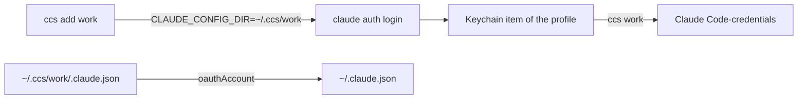

<!-- 翻譯自 README.md 初版。只翻 "For AI agents" 以上的章節，英文版更新時一起改。 -->

<div align="center">

<h1>ccs</h1>

<p><strong>在 macOS 上用一個指令切換 Claude Code 帳號。</strong></p>

[](https://github.com/zyx1121/ccs/actions)
[](https://github.com/zyx1121/ccs/releases)
[](LICENSE)

[English](README.md) | **繁體中文** | [简体中文](README.zh-CN.md)

</div>

```console
$ ccs
  loki  loki@winlab.tw
* mike  lms025187@winlab.tw
$ ccs loki
switched to loki (loki@winlab.tw)
restart running Claude Code sessions to use it
```

一台 Mac 上有好幾個 Claude 帳號時用它。每個帳號登入一次，之後切換約 0.1 秒。

## 功能

- **新增帳號**：`ccs add <name>` 執行官方的 `claude auth login`，並存下結果。
- **切換帳號**：`ccs <name>` 改變之後每個新 Claude Code session 用的帳號。
- **保留 MCP 登入**：切換只換 Claude 的 token，MCP 伺服器的登入不受影響。
- **保留輪替後的 token**：切換前，ccs 先存下要離開的帳號最新的 token。

## 快速開始

```sh
cargo install --git https://github.com/zyx1121/ccs
ccs add loki
```

```text
Opening browser to sign in…
Login successful.
added loki (loki@winlab.tw)
```

## 用法

| 指令 | 作用 |
|------|------|
| `ccs` | 列出帳號，`*` 標出目前用的帳號。 |
| `ccs add <name> [args]` | 登入並存成 `<name>`。多的參數交給 `claude auth login`，例如 `--email`。 |
| `ccs <name>` 或 `ccs switch <name>` | 把 `<name>` 設為目前帳號。 |
| `ccs rm <name>` | 刪掉 `<name>`。正在用的帳號仍保持登入。 |

第一次切換前，先把目前用的帳號加進來。不然 ccs 會拒絕，因為切換會把那個帳號登出。

## 設定

| 變數 | 設定 | 預設 |
|------|------|------|
| `CCS_HOME` | 存放每個帳號 profile 的目錄 | `~/.ccs` |

## 運作方式



每個帳號是 `~/.ccs/<name>` 裡的一個 Claude Code profile。Claude Code 把 token 存在 macOS 鑰匙圈，項目名稱由 profile 路徑算出。切換時，ccs 把 token 複製到預設項目、把身分寫進 `~/.claude.json`，過程中拿著 Claude Code 更新 token 時用的同一組鎖。
